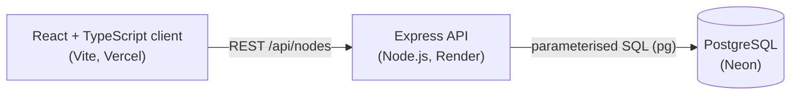
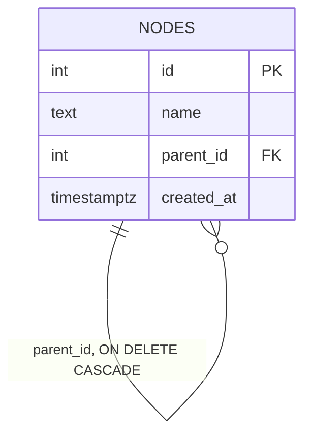

<div align="center">


<br/>


<br/><br/>

<a href="https://recursive-node-tree-sepia.vercel.app/">
  
</a>
&nbsp;
<a href="https://github.com/1809gaurav/recursive-node-tree">
  
</a>
&nbsp;


<br/><br/>

<a href="#preview">Preview</a> ·
<a href="#features">Features</a> ·
<a href="#architecture">Architecture</a> ·
<a href="#how-it-works">How it works</a> ·
<a href="#design-decisions">Decisions</a> ·
<a href="#api">API</a> ·
<a href="#run-locally">Run locally</a> ·
<a href="#deployment">Deploy</a>

</div>

<br/>

<p align="center">
A single-page app where every node can hold more nodes, to any depth. Create root nodes, add children under any node, expand or collapse each branch, and delete a node together with everything beneath it. The tree is drawn as a flow diagram that fills the whole screen, can run left-to-right or top-down, and is stored in PostgreSQL so it survives a refresh.
</p>

<div align="center">

</div>

<br/>

<h2 align="center" id="preview">Preview</h2>

<div align="center">


<p><sub>Left: horizontal flow, light theme. Right: vertical flow, dark theme.</sub></p>
</div>

<br/>

<div align="center">

</div>

<br/>

<h3 align="center" id="features">Features</h3>

<div align="center">

| | |
|:--|:--|
| **Recursive rendering** | One `TreeNode` component renders its own children, so there is no depth limit |
| **Collapsed by default** | Every node starts collapsed, with its own expand / collapse toggle |
| **Flexible structure** | Multiple root nodes, and any node can have any number of children |
| **Add anywhere** | An add box appears under every expanded node, and the parent opens to show the new child |
| **Cascade delete** | Deleting a node removes all of its descendants, after a confirmation that shows how many |
| **Persistent** | Stored in PostgreSQL, so the tree is still there after a refresh |
| **Two layouts** | A horizontal (left to right) and a vertical (top down) flow diagram, with the choice remembered |
| **Light and dark theme** | Follows the system setting, can be switched by hand, and is remembered |
| **Full-screen canvas** | The diagram fills the window and scrolls inside itself, so the page never jumps |
| **Solid UX** | Loading, empty and error states, a retry button, and input validation on client and server |

</div>

<div align="center">

</div>

<br/>

<h3 align="center">Tech Stack</h3>

<div align="center">


</div>

<br/>

<div align="center">

</div>

<br/>

<h3 align="center" id="architecture">Architecture</h3>



**Data model.** One self-referencing table. Each row points to its parent, and roots have no parent.



```sql
CREATE TABLE IF NOT EXISTS nodes (
  id         SERIAL PRIMARY KEY,
  name       TEXT NOT NULL CHECK (length(trim(name)) > 0),
  parent_id  INTEGER REFERENCES nodes(id) ON DELETE CASCADE,
  created_at TIMESTAMPTZ NOT NULL DEFAULT now()
);
CREATE INDEX IF NOT EXISTS idx_nodes_parent_id ON nodes(parent_id);
```

<br/>

<h3 align="center" id="how-it-works">How It Works</h3>

<div align="center">

| | |
|:--|:--|
| **01 · Store** | An adjacency list: every row holds its `parent_id`, and root nodes have `parent_id = NULL`. |
| **02 · Serve** | `GET /api/nodes` returns the flat list. `POST` creates a node and `DELETE` removes one. |
| **03 · Load** | The client keeps the flat list in state as the single source of truth. |
| **04 · Nest** | `buildTree` puts every row in a `Map` by id, then links each row to its parent in one pass: O(n). `useMemo` rebuilds it only when the list changes. |
| **05 · Render** | `TreeNode` maps over `node.children` and renders itself for each one. A node with no children is the base case that stops the recursion. |
| **06 · Update** | After a successful add or delete, the flat list is updated locally, so the screen changes instantly and matches the database. |

</div>

<div align="center">

</div>

<br/>

<h3 align="center" id="design-decisions">Design Decisions</h3>

<div align="center">

| Decision | Why |
|:--|:--|
| **Adjacency list** (`parent_id`) | The simplest way to store a tree in SQL. Adding a node is one insert, and moving or deleting a branch stays cheap. |
| **`ON DELETE CASCADE`** | PostgreSQL removes every descendant in one query, so there is no recursive delete code to maintain and no orphaned rows. |
| **PostgreSQL over a document database** | The data is a relationship with a rule: a child must have a real parent. Foreign keys enforce that for free. |
| **Flat list from the API, tree built on the client** | One simple query and one simple response, with no recursive SQL and no per-node requests. |
| **Flat list as the single source of truth** | The tree is derived from it, so add and delete are one-line state updates with nothing to keep in sync. |
| **API calls in one file** (`api.ts`) | Components never call `fetch` directly, so an endpoint change is fixed in one place. |
| **Layouts and themes in CSS only** | `TreeNode` has the same markup in every mode. A class on the board and a `data-theme` attribute change the look, so no component logic is duplicated. |
| **Validation on both sides** | The UI gives instant feedback, and the server never trusts the client. |

</div>

<br/>

<h3 align="center">Edge Cases Handled</h3>

- Empty or whitespace-only names are rejected by the form, the API and a database `CHECK`.
- Names over 200 characters are rejected.
- An invalid `parentId` returns `400`, and a parent that does not exist returns `404`.
- Deleting a missing node returns `404`, and an invalid id returns `400`.
- Double-clicking Add cannot create duplicates, because the button is disabled while a request is running.
- If a save fails, the typed text is kept so it can be retried.
- A failed request shows an error banner with a **Reload** button, not a blank page.
- Loading and empty states are shown, and toggles and buttons have labels for screen readers and keyboard focus styles.
- Motion respects `prefers-reduced-motion`.

<div align="center">

</div>

<br/>

<h3 align="center" id="api">API</h3>

<div align="center">

| Method | Route | Body | Result |
|:--|:--|:--|:--|
| `GET` | `/api/nodes` | | `200` flat list of nodes |
| `POST` | `/api/nodes` | `{ "name": "Fruits", "parentId": null }` | `201` the created node |
| `DELETE` | `/api/nodes/:id` | | `204` node and all descendants removed |
| `GET` | `/health` | | `200` `{ "ok": true }` |

</div>

```bash
# create a root, then a child under it
curl -X POST http://localhost:4000/api/nodes -H "Content-Type: application/json" -d '{"name":"Fruits"}'
curl -X POST http://localhost:4000/api/nodes -H "Content-Type: application/json" -d '{"name":"Apple","parentId":1}'

# list everything
curl http://localhost:4000/api/nodes

# delete Fruits and everything under it
curl -X DELETE http://localhost:4000/api/nodes/1
```

<p align="center"><sub>Errors return JSON like <code>{ "error": "Name is required." }</code> with a 400, 404 or 500 status.</sub></p>

<br/>

<h3 align="center">Project Structure</h3>

```
recursive-node-tree/
├── server/
│   ├── schema.sql              nodes table (parent_id + ON DELETE CASCADE)
│   ├── .env.example            template for local settings
│   └── src/
│       ├── db.js               pg pool and table setup on startup
│       └── index.js            REST API: GET / POST / DELETE
└── client/
    ├── .env.example
    └── src/
        ├── api.ts              fetch wrapper with error handling
        ├── tree.ts             buildTree, countDescendants, collectIds
        ├── types.ts            NodeRow and TreeNodeData
        ├── App.tsx             state, loading, errors, add and delete
        ├── styles.css          themes, layouts, full-screen canvas
        └── components/
            ├── TreeNode.tsx    the recursive component
            ├── AddNodeForm.tsx reusable add form (roots and children)
            ├── LayoutToggle.tsx
            └── ThemeToggle.tsx
```

<div align="center">

</div>

<br/>

<h3 align="center" id="run-locally">Run Locally</h3>

You need Node.js 18+ and a PostgreSQL database. A free [Neon](https://neon.tech) project works well, or you can run PostgreSQL in Docker.

```bash
# 1. Clone
git clone https://github.com/1809gaurav/recursive-node-tree.git
cd recursive-node-tree

# 2. Backend
cd server
cp .env.example .env        # then fill in DATABASE_URL
npm install
npm run dev                 # http://localhost:4000 (creates the table on start)

# 3. Frontend (in a second terminal)
cd client
npm install
npm run dev                 # http://localhost:5173 (proxies /api to :4000)
```

**Environment variables**

| File | Variable | Purpose |
|:--|:--|:--|
| `server/.env` | `DATABASE_URL` | PostgreSQL connection string |
| `server/.env` | `DATABASE_SSL` | `true` for hosted databases such as Neon, `false` for local |
| `server/.env` | `CLIENT_ORIGIN` | Allowed frontend origin(s) for CORS, comma-separated, no trailing slash |
| `server/.env` | `PORT` | API port (default `4000`) |
| `client/.env` | `VITE_API_URL` | Backend URL in production; leave empty in development |

**Scripts**

| Where | Command | What it does |
|:--|:--|:--|
| `server` | `npm run dev` | Starts the API and restarts it when files change |
| `server` | `npm start` | Starts the API (used in production) |
| `client` | `npm run dev` | Starts the Vite dev server |
| `client` | `npm run build` | Type-checks and builds to `dist/` |

<br/>

<h3 align="center" id="deployment">Deployment</h3>

<div align="center">

| Part | Host | Settings |
|:--|:--|:--|
| Database | Neon | Free hosted PostgreSQL |
| Backend | Render | Root directory `server`, build `npm install`, start `npm start` |
| Frontend | Vercel | Root directory `client`, build `npm run build`, output `dist` |

</div>

<p align="center"><sub>Set <code>CLIENT_ORIGIN</code> on Render to the exact Vercel URL, and <code>VITE_API_URL</code> on Vercel to the Render URL. The backend runs on a free Render instance, so the first request after a quiet period can take a little while while it wakes up.</sub></p>

<div align="center">

</div>

<br/>

<h3 align="center">Ideas for Next</h3>

- Rename a node in place
- Move a node by drag and drop
- Load children only when a node is expanded, for very large trees
- A "fit to screen" button for wide diagrams
- Automated tests for `buildTree` and the API routes

<br/>

<h3 align="center">Built By</h3>

<table align="center">
<tr>
<td align="center" width="220">
<br/>
<b>Gaurav Kaushik</b><br/>
<sub>Full-Stack Developer</sub><br/>
<a href="https://github.com/1809gaurav">@1809gaurav</a>
</td>
</tr>
</table>

<br/>

